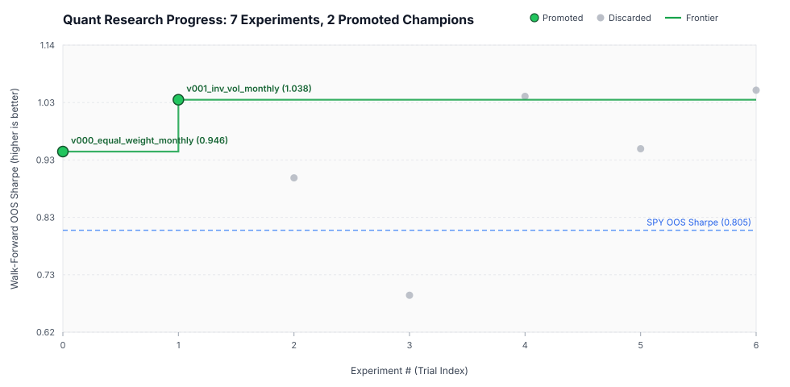

# quant_research_lab

Offline autonomous quantitative research and purged walk-forward backtesting sandbox (Python 3.11+, `uv`), combining hardened anti-overfitting controls with autonomous experiment tooling inspired by [karpathy/autoresearch](https://github.com/karpathy/autoresearch).



> **Research-only boundary:** Offline historical simulation only — not investment advice, no live brokerage integrations, and no order-routing code.

---

## How This Autoresearch Project Works

This repository runs a disciplined, autonomous **hypothesize → implement → test → audit → promote/discard** loop modeled on `karpathy/autoresearch`, adapted for quantitative finance:

1. **Immutable Harness vs. Editable Strategies:** Just as `autoresearch` keeps `prepare.py` read-only and lets the agent edit only `train.py`, here `config/risk_policy.json` (SHA-256 verified on every run), `data/` (frozen total-return CSV + manifest SHA-256), and `src/engine/` are **immutable during optimization**. Only new candidate strategy files under `src/strategies/` are added and evaluated.
2. **Strict Causality & Adversarial Rigor:** Before scoring any candidate, `src/engine/validation.py` automatically verifies:
   - **Determinism** (repeated calls produce identical weights),
   - **Input immutability** (`prices` and `params` are never mutated in-place),
   - **Prefix-truncation & fixed-length future-shock invariance** (no lookahead bias),
   - **Next-bar execution (`signal_lag_bars = 1`)** with realistic weight-drift turnover and 5 bps/side transaction costs (1 bps commission + 4 bps slippage), plus 1×/2×/3× cost-sensitivity sweeps.
3. **Purged Walk-Forward & Locked Holdout:** Candidates are evaluated strictly on expanding-train, 21-day-purged walk-forward folds inside the development window (`2005-01-03` to `2023-12-29`). The final holdout window (`2024-01-02` onward) is programmatically sealed from the optimization loop.
4. **Hard Promotion Gates & Anti-Overfitting:** A candidate is promoted (`PROMOTE` / `keep`) to `experiments/best_candidate/` **only** if it improves purged walk-forward OOS net Sharpe by at least `+0.05` over the current champion **without** breaching any policy ceiling (max OOS drawdown `-25%`, max annual turnover `600%`, min `24` rebalance events, max IS→OOS Sharpe degradation `0.50`, max parameter-perturbation Sharpe drop `0.20`). Every run also tracks `trial_count` and computes the multiple-testing-adjusted **Deflated Sharpe Ratio (DSR)**.
5. **Interpretable Outputs & Concise Reasoning Traces:** Every cycle (promoted, discarded, or crashed) is appended to `experiments/ledger.jsonl`, synced to the compact tab-separated ledger `experiments/results.tsv`, plotted on `experiments/progress.svg`, and summarized into a concise 5-line evidence-backed reasoning trace (`Verdict`, `Evidence`, `Drivers`, `Audit`, `Next`) in `experiments/reasoning_traces.md`.

---

## What Is Being Refined

The autonomous loop refines **long-only, daily-tracked multi-asset ETF portfolio allocation strategies** across a survivorship-safe 6-ETF universe:

- **Equities:** `SPY` (S&P 500), `QQQ` (Nasdaq-100), `IWM` (Russell 2000)
- **Rates & Defensive / Real Assets:** `TLT` (20+ Yr Treasuries), `GLD` (Gold), `SHY` (1–3 Yr Treasuries / defensive cash proxy)

**Optimization target:** Maximize net **Purged Walk-Forward Out-of-Sample Sharpe Ratio** (subject to `max_gross_leverage <= 1.0`, `max_single_asset_weight <= 0.50`, no shorting, and all risk/stability gates) while favoring **simplicity** (fewer parameters and lower SLOC) and low turnover.

---

## Experiment History Ledger (`cycle_000` – `cycle_009`)

Development window: `2005-01-03` to `2023-12-29` (7 purged walk-forward OOS folds; `SPY` Buy & Hold OOS benchmark: Sharpe **`0.805`**, Max DD **`-33.72%`**, CAGR **`13.24%`**). Full machine-readable history lives in [`experiments/ledger.jsonl`](experiments/ledger.jsonl) and [`experiments/results.tsv`](experiments/results.tsv).

| Cycle | Strategy | Strategy Note | Decision | OOS Sharpe | IS Sharpe | OOS CAGR | OOS Max DD | Annual Turnover | Perturb Drop | SLOC | Params | Failed Gates |
| --- | --- | --- | --- | ---: | ---: | ---: | ---: | ---: | ---: | ---: | ---: | --- |
| `cycle_000` | `v000_equal_weight_monthly` | Monthly equal-weight (1/6) across all 6 ETFs (naive baseline). | **PROMOTE** | `0.946` | `0.612` | `9.05%` | `-22.71%` | `16.0%` | `0.000` | 37 | 1 | none |
| `cycle_001` | `v001_inv_vol_monthly` | Monthly 63d inverse-volatility weighting with 4% vol floor and 45% cap. | **PROMOTE** | **`1.038`** | `1.017` | `6.36%` | `-16.15%` | `38.7%` | `0.028` | 72 | 4 | none |
| `cycle_002` | `v002_inv_vol_trend_filter` | Inverse-vol with binary 126d SMA trend cutoff routing below-SMA assets to cash. | DISCARD | `0.899` | `1.158` | `4.23%` | `-8.61%` | `96.8%` | `0.017` | 77 | 6 | `beats_champion_margin` |
| `cycle_003` | `v003_inv_vol_top_momentum` | Inverse-vol concentrated in top-3 ETFs ranked by trailing 126d momentum. | DISCARD | `0.689` | `0.603` | `8.23%` | `-27.40%` | `261.0%` | `0.003` | 68 | 6 | `max_oos_drawdown`, `beats_champion_margin` |
| `cycle_004` | `v004_corr_aware_risk_parity` | Inverse-vol penalized by average positive 63d pairwise correlation. | DISCARD | `1.045` | `1.065` | `6.17%` | `-16.08%` | `39.5%` | `0.022` | 64 | 5 | `beats_champion_margin` |
| `cycle_005` | `v005_soft_trend_inv_vol` | Inverse-vol tilted smoothly by exp(0.5 * z_excess_return vs SHY), 100% invested. | DISCARD | `0.951` | `0.926` | `6.69%` | `-16.58%` | `90.0%` | `0.031` | 73 | 7 | `beats_champion_margin` |
| `cycle_006` | `v006_vol_targeted_inv_vol` | Inverse-vol risky sleeve scaled to 8% fast 21d portfolio vol target; excess to SHY/cash. | DISCARD | `1.055` | `0.874` | `8.70%` | `-18.17%` | `149.1%` | `0.033` | 79 | 7 | `beats_champion_margin` |
| `cycle_007` | `v007_erc_risk_parity` | True Equal Risk Contribution (ERC) solved on shrunk 126d covariance matrix. | DISCARD | `0.818` | `0.271` | `7.34%` | `-19.23%` | `74.2%` | `0.073` | 87 | 5 | `beats_champion_margin` |
| `cycle_008` | `v008_downside_vol_inv_weight` | Inverse-risk weighting blending 60% downside semideviation and 40% total vol. | DISCARD | `1.040` | `1.005` | `6.37%` | `-16.26%` | `44.3%` | `0.031` | 67 | 5 | `beats_champion_margin` |
| `cycle_009` | `v009_rate_regime_inv_vol` | Inverse-vol scaling down TLT when trailing 63d SPY-TLT correlation turns positive. | DISCARD | `1.042` | `1.000` | `6.38%` | `-16.10%` | `38.9%` | `0.001` | 83 | 6 | `beats_champion_margin` |

---

## Column Glossary (History Ledger & `experiments/results.tsv`)

| Column | Appears In | Meaning |
| --- | --- | --- |
| `commit` | `results.tsv` | Short 7-character git commit hash at the time the experiment was recorded. |
| `Cycle` / `cycle_id` | Both | Sequential experiment identifier (`cycle_000`, `cycle_001`, …) matching `experiments/ledger.jsonl`. |
| `Strategy` / `strategy` | Both | Unique strategy name defined by `STRATEGY_NAME` in `src/strategies/vNNN_*.py`. |
| `Strategy Note` / `strategy_note` | Both | Concise single-line summary of the strategy's allocation rule and economic mechanism. |
| `Decision` / `status` | Both | Audit outcome: `PROMOTE` (`keep` in TSV) when all gates and the `+0.05` OOS Sharpe margin pass; `DISCARD` (`discard`) otherwise; `CRASH` (`crash`) on exception/timeout. |
| `OOS Sharpe` / `oos_sharpe` | Both | **Primary objective:** Annualized net Sharpe ratio stitched across all 7 purged walk-forward out-of-sample test folds (after 5 bps/side costs). |
| `IS Sharpe` | README / `ledger.jsonl` | Annualized net Sharpe ratio on the initial in-sample training fold (used to check `IS - OOS <= 0.50` overfitting degradation). |
| `OOS CAGR` | README / `ledger.jsonl` | Compound annual growth rate (net of transaction costs) across the stitched OOS test folds. |
| `OOS Max DD` / `oos_max_dd` | Both | Peak-to-trough maximum drawdown across the stitched OOS test folds (policy ceiling: `>= -25.0%`). |
| `Annual Turnover` / `annual_turnover` | Both | Average annualized one-way portfolio turnover accounting for daily weight drift between rebalances (policy ceiling: `<= 600%`, i.e. `6.0`). |
| `Perturb Drop` | README / `ledger.jsonl` | Worst OOS Sharpe drop across neighboring parameter values in `NEIGHBOR_PARAMS` (anti-cliff gate: `<= 0.20`). |
| `SLOC` / `sloc` | Both | Non-blank, non-comment source lines of code in the strategy module (simplicity metric). |
| `Params` / `params` | Both | Number of tunable hyperparameters in `DEFAULT_PARAMS` (degrees-of-freedom / simplicity metric). |
| `Failed Gates` | README / `ledger.jsonl` | List of policy gates that rejected the candidate (e.g., `beats_champion_margin`, `max_oos_drawdown`), or `none` if promoted. |
| `description` | `results.tsv` | Full falsifiable hypothesis statement (or crash error message) sanitized to a single TSV field. |

---

## Layout

- `PROMPT.md` — Hardened recursive research loop specification and guardrails.
- `AUTORESEARCH.md` — Autonomous experiment playbook adapted from [karpathy/autoresearch](https://github.com/karpathy/autoresearch) (`program.md`), preserving `quant_research_lab`'s immutable policy, causality checks, and locked holdout.
- `config/risk_policy.json` — Immutable risk ceilings, execution assumptions, survivorship-safe ETF universe (`SPY`, `QQQ`, `IWM`, `TLT`, `GLD`, `SHY`), purged walk-forward splits, and locked `2024+` holdout boundary (SHA-256 verified on every cycle).
- `data/` — Frozen total-return (`auto_adjust=True`) daily ETF dataset (`etf_daily_total_return.csv`) and `manifest.json` with SHA-256 provenance.
- `src/engine/` — Deterministic next-bar execution backtester with PSR/DSR & portfolio attribution (`backtest.py`), immutable policy & gate checker (`policy.py`), purged walk-forward + determinism/immutability/prefix-and-future-shock lookahead + perturbation + fold-consistency & stress-regime/cost diagnostics (`validation.py`), concise reasoning trace generator (`reasoning.py`), and cycle runner (`runner.py`).
- `src/strategies/` — Isolated, deterministic, strictly causal candidate strategies (`v000_baseline.py` through `v009_rate_regime_inv_vol.py`).
- `src/tools/` & `scripts/` — Autoresearch-inspired experiment tooling: single-command runner with timeout, crash logging, and grep-friendly summary (`scripts/run_experiment.py`), AST/parameter simplicity auditor (`src/tools/complexity.py`), tab-separated `results.tsv` exporter (`src/tools/results_tsv.py`), and progress analyzer + zero-dependency SVG frontier chart (`scripts/analyze_experiments.py`).
- `experiments/` — Append-only experiment log (`ledger.jsonl`), compact tab-separated view (`results.tsv`), chronological concise reasoning traces (`reasoning_traces.md`), OOS Sharpe frontier chart (`progress.svg`), one-time sealed holdout audit (`holdout_audit.json`), and promoted champion snapshot (`best_candidate/`).
- `tests/` — Offline rigor tests verifying causality/no-lookahead, determinism, input immutability, NaN/Inf/corrupt-data rejection, leverage/concentration caps, locked holdout enforcement, DSR multiple-testing monotonicity, attribution accuracy, reasoning traces, and experiment tooling.

## Quickstart

```bash
uv sync --extra dev
uv run ruff check src tests scripts
uv run pytest -v

# Analyze experiment history, sync experiments/results.tsv & reasoning_traces.md, and render experiments/progress.svg
uv run scripts/analyze_experiments.py

# Dry-run a candidate strategy with autoresearch-style grep-friendly output + concise reasoning trace
uv run scripts/run_experiment.py --strategy src/strategies/v001_inv_vol.py --dry-run
```
